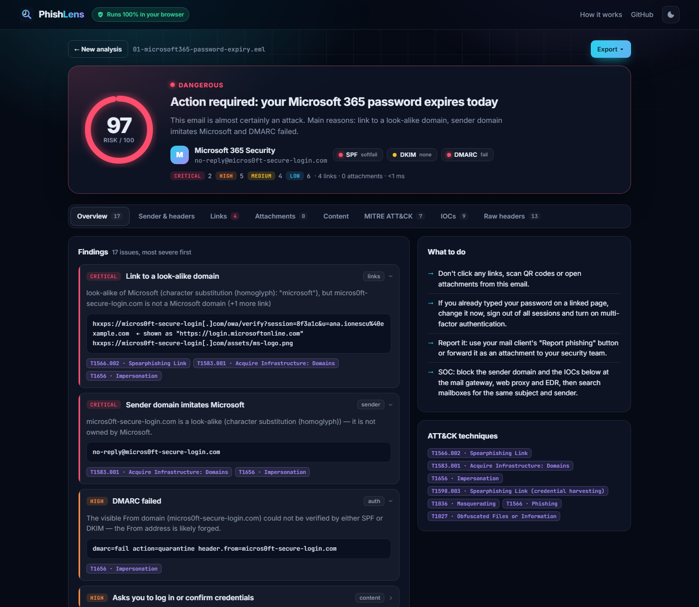
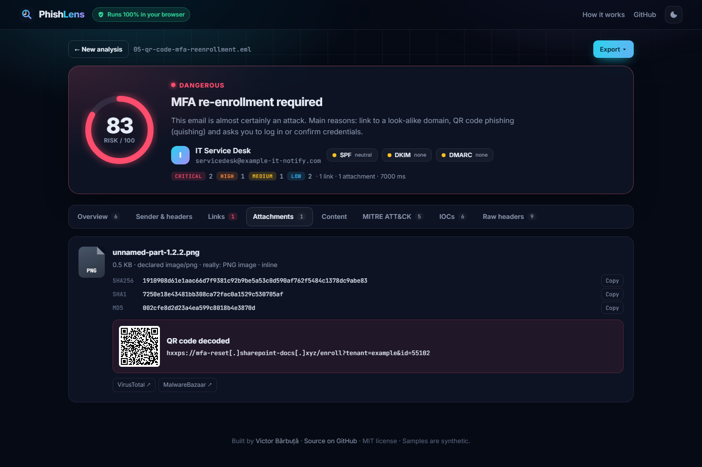
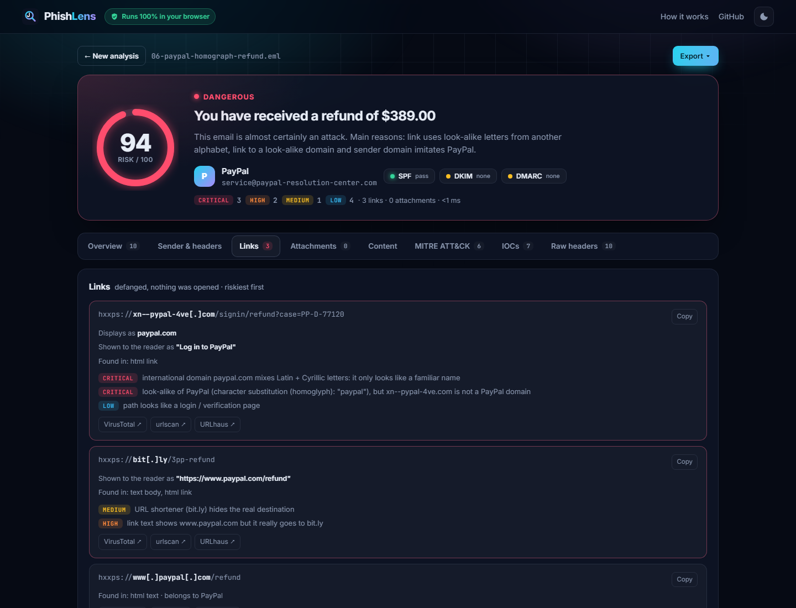
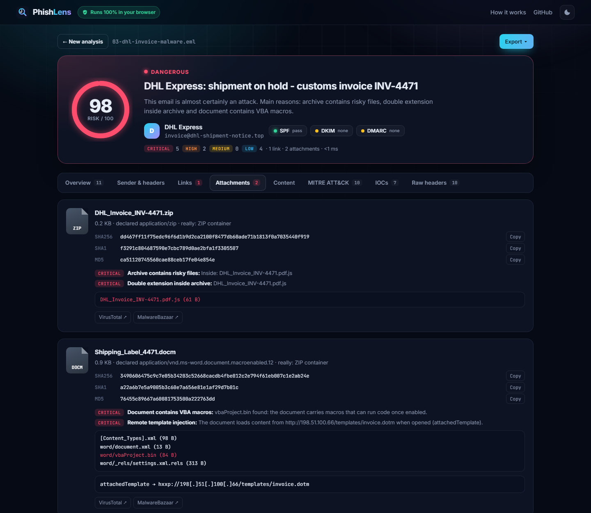
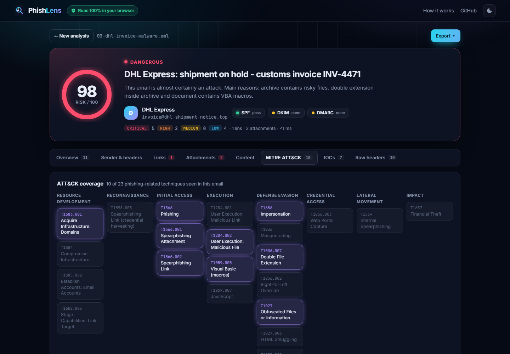
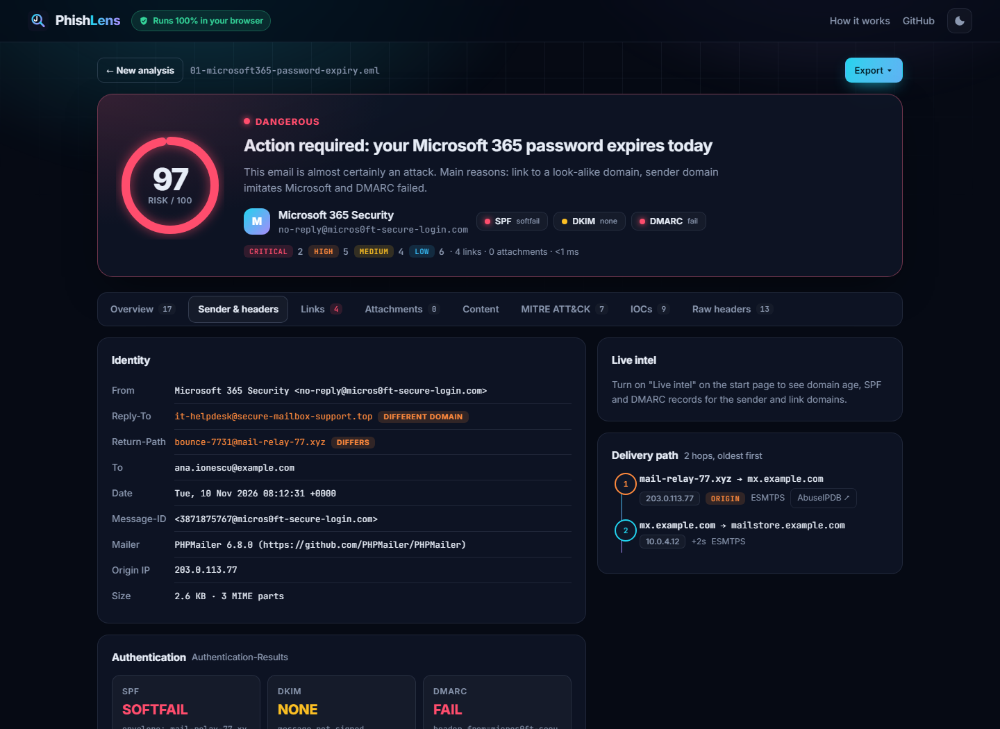
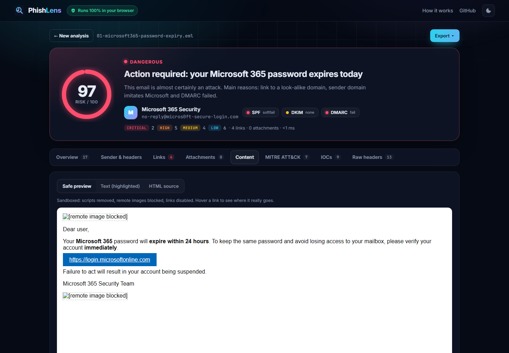
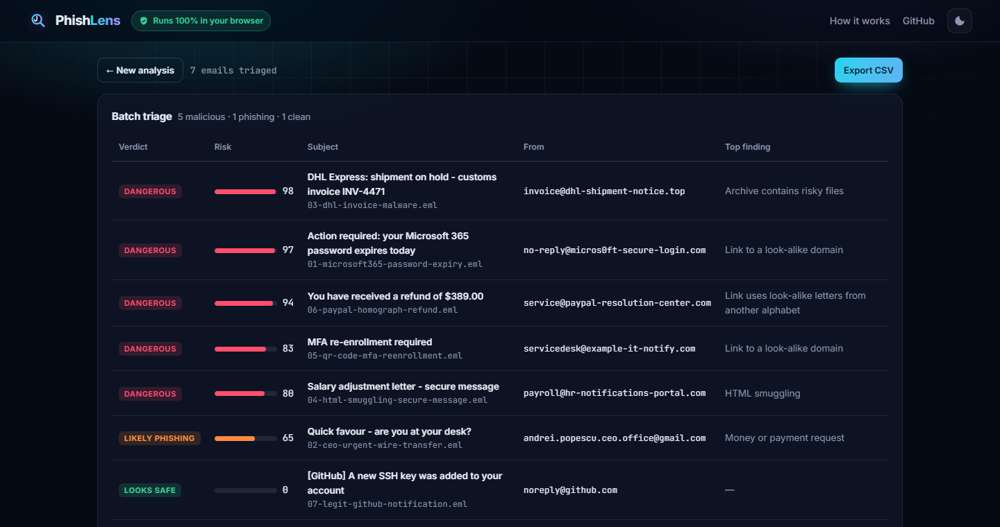
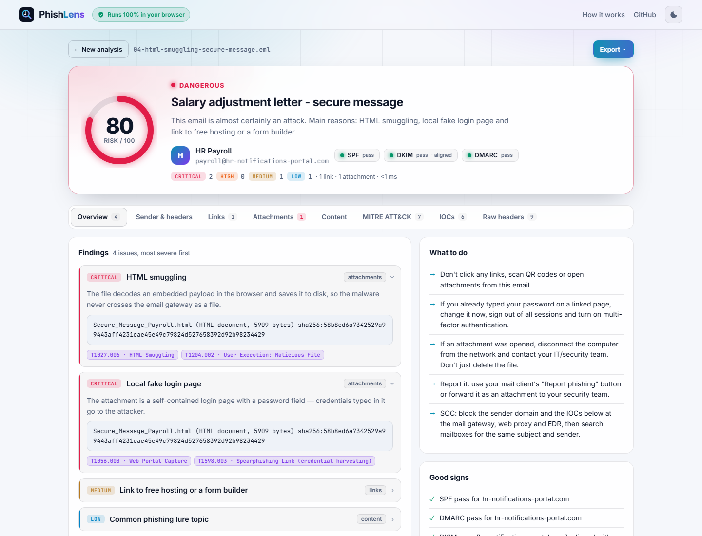
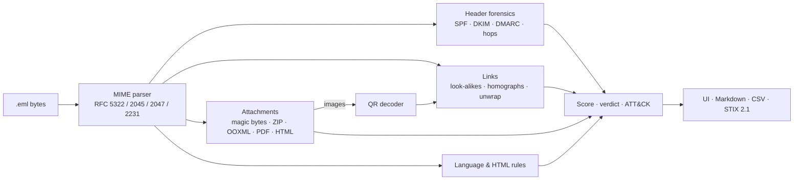

<div align="center">

# 🎣 PhishLens

**Is this email phishing? Drop it in and find out in one second.**

A phishing email analyzer for SOC analysts. It checks the sender's authentication, the links, the attachments, any QR codes and the wording, explains in plain English why the email is (or isn't) phishing, maps every finding to **MITRE ATT&CK** and hands you the IOCs ready to block.

### [▶ Try the live demo](https://vicuvi1.github.io/phishlens/) · [Watch it catch a QR-code phish](https://vicuvi1.github.io/phishlens/#sample=05&tab=attachments) · [Triage 7 emails at once](https://vicuvi1.github.io/phishlens/#batch=samples)




</div>

## Why it's different

- **Your email never leaves your browser.** No server, no upload, no account. The whole engine (including a MIME parser I wrote from scratch) runs as JavaScript on the page. You can paste real suspicious mail into it without leaking anything.
- **It explains instead of just scoring.** Every finding says what's wrong in plain English, shows the evidence and links to the ATT&CK technique.
- **It doesn't cry wolf.** A fully authenticated real GitHub email scores **0/100**, while a CEO-fraud email that *passes* SPF, DKIM and DMARC is still caught.
- **Zero dependencies**, one engine for the web UI and the CLI, 24 tests, CI on Node 20/22/24 and CodeQL.

## What it checks

| Area | Checks |
|---|---|
| 🛡️ **Sender & authentication** | SPF / DKIM / DMARC results and DKIM alignment, look-alike sender domains, display-name spoofing (a brand or another address in the name), executive names on free webmail, Reply-To and Return-Path mismatches, Message-ID origin, bulk-mailer clients, the Received chain with the origin IP and timestamp anomalies |
| 🔗 **Links** | Look-alike domains (typosquats, combosquats, homoglyphs like `micros0ft`), punycode homographs (`pаypal.com` with a Cyrillic "а"), link text that shows one site but goes to another, `@` tricks, raw IPs, URL shorteners, abused free hosting, risky downloads, `data:`/`javascript:` links and open redirects. It also unwraps Microsoft Safe Links and Proofpoint URLs |
| 🔳 **QR codes (quishing)** | Decodes QR codes in image attachments and inline images and analyses the hidden link |
| 📎 **Attachments** | MD5 / SHA-1 / SHA-256, real file type from magic bytes vs the extension, double extensions, right-to-left-override names, executables, ISO/IMG, OneNote, ZIP listing (risky files, encryption), Office VBA macros and **remote template injection**, PDF JavaScript / Launch / embedded files, **HTML smuggling**, offline fake login pages, SVG with script |
| 💬 **Content** | Credential requests, BEC payment requests, urgency, threats and lures (English + Romanian), a password given for an attachment, forms and scripts in the body, hidden text, image-only emails |
| 🌐 **Live intel** *(opt-in)* | Domain age via RDAP ("registered 3 days ago"), SPF / DMARC / MX records via DNS-over-HTTPS. Only domain names are sent |
| 📤 **Output** | 0–100 risk score and verdict, plain-English summary, what to do next, defanged IOCs, VirusTotal / urlscan / URLhaus / AbuseIPDB / MalwareBazaar pivots, and exports: **Markdown incident report, IOC CSV, STIX 2.1 bundle, JSON**. Plus **batch triage** for many emails at once |

## Screenshots

| | |
|---|---|
|  **QR-code phishing:** the QR image is decoded and its link flagged as a SharePoint look-alike |  **Links:** a Cyrillic homograph of paypal.com and a bit.ly link posing as PayPal |
|  **Attachments:** `.pdf.js` hidden in a ZIP, VBA macros and remote template injection |  **MITRE ATT&CK:** coverage matrix for the email |
|  **Header forensics:** identity mismatches, SPF/DKIM/DMARC, the delivery path |  **Safe preview:** sandboxed iframe, scripts stripped, remote images blocked, links disabled |
|  **Batch triage:** many emails ranked by risk |  **Light theme:** HTML smuggling caught even with SPF, DKIM and DMARC all passing |

## Use it

**In the browser:** open the [live demo](https://vicuvi1.github.io/phishlens/) and drop an `.eml` file (Outlook / Gmail / Thunderbird: "Download" or "Save as"), or paste the raw source. To run it locally:

```bash
git clone https://github.com/vicuvi1/phishlens.git && cd phishlens
node tools/serve.js          # → http://127.0.0.1:5180
```

**From the terminal or a pipeline** (Node 20+, no `npm install`):

```bash
node cli.js samples/*.eml                     # coloured summary
node cli.js mail.eml --md   > report.md       # incident report
node cli.js mail.eml --stix > iocs.json       # STIX 2.1 for a TIP / SIEM
node cli.js mail.eml --csv                    # IOC list
node cli.js mail.eml --live                   # + domain age and SPF/DMARC lookups
node cli.js mail.eml --fail-above 44          # exit code 2 when risky (mail-flow / CI gate)
```

```
01-microsoft365-password-expiry.eml
   DANGEROUS   risk 97/100
  From:    Microsoft 365 Security <no-reply@micros0ft-secure-login.com>
  Auth:    SPF=softfail DKIM=none DMARC=fail

  CRITICAL Link to a look-alike domain  [T1566.002, T1583.001, T1656]
  CRITICAL Sender domain imitates Microsoft  [T1583.001, T1656]
  HIGH     DMARC failed  [T1656]
  HIGH     Link text hides the real destination  [T1566.002, T1036]
```

Docker: `docker build -t phishlens . && docker run --rm -v "$PWD/samples:/mail:ro" phishlens /mail/03-dhl-invoice-malware.eml`

## Samples

Seven synthetic emails in [`samples/`](samples), generated by [`tools/make_samples.py`](tools/make_samples.py):

| Sample | Technique | Verdict |
|---|---|---|
| `01-microsoft365-password-expiry` | Look-alike domain, DMARC fail, link text ≠ destination | 🟥 Dangerous · 97 |
| `02-ceo-urgent-wire-transfer` | CEO fraud / BEC from Gmail that **passes SPF, DKIM and DMARC** | 🟧 Likely phishing · 65 |
| `03-dhl-invoice-malware` | `.pdf.js` in a ZIP, macro document with remote template injection | 🟥 Dangerous · 98 |
| `04-html-smuggling-secure-message` | HTML smuggling + offline credential form | 🟥 Dangerous · 80 |
| `05-qr-code-mfa-reenrollment` | QR-code phishing (quishing) | 🟥 Dangerous · 83 |
| `06-paypal-homograph-refund` | Punycode homograph, URL shortener | 🟥 Dangerous · 94 |
| `07-legit-github-notification` | Legitimate, fully authenticated mail (control) | 🟩 Looks safe · 0 |

All harmless: recipients use `example.com`, sender IPs are RFC 5737 documentation addresses and the "payloads" are plain text.

## How it works



```
src/
├── mime.js          MIME parser (encoded words, RFC 2231 filenames, multipart, byte-exact attachments)
├── headers.js       sender identity, Authentication-Results, DKIM signatures, Received chain
├── domains.js       registrable domains, punycode decoder, confusables skeleton, look-alike brand detection
├── urls.js          link extraction (text, HTML, forms, attachments), per-URL flags, Safe Links / Proofpoint unwrapping
├── attachments.js   hashes, magic bytes, ZIP reader, OOXML macros + template injection, PDF, HTML smuggling
├── language.js      social-engineering rules (EN + RO), HTML body tricks
├── live.js          optional RDAP + DNS-over-HTTPS lookups
├── score.js         probabilistic score, verdict, summary, recommendations
├── report.js        Markdown, CSV (formula-injection safe), STIX 2.1
└── qr-node.js       tiny PNG decoder + jsQR for the CLI
```

### Security of the tool itself

Attackers control every byte of an email, so the analyzer treats it as hostile:

- Email content is only ever inserted with `textContent` / DOM APIs, never `innerHTML`.
- The HTML preview is built from an inert `DOMParser` document with scripts, event handlers, forms, remote resources and link targets stripped, then shown in an `<iframe sandbox>` with its own `default-src 'none'` CSP.
- A strict page CSP (`script-src 'self'`, no inline scripts, no `eval`).
- Attachments are only read as bytes. Nothing is opened, rendered or executed, and no URL from an email is ever fetched.
- CSV exports are guarded against formula injection; IOCs are defanged by default.

## Tests

```bash
node --test
```

24 tests: MIME edge cases, MD5 test vectors, punycode, look-alike detection (including *not* flagging the real brands), URL flags, Safe Links/Proofpoint unwrapping, header parsing, scoring, live-intel logic (mocked network), real QR decoding, and an end-to-end test for every sample.

## Roadmap

- [ ] `.msg` (Outlook) file support
- [ ] YARA rules for attachments
- [ ] ARC chain validation and real DKIM signature verification
- [ ] Browser extension: "Analyse with PhishLens" from Gmail / Outlook Web

## License

MIT © Victor Bărbuță · jsQR (Apache-2.0) is vendored in [`vendor/`](vendor)
